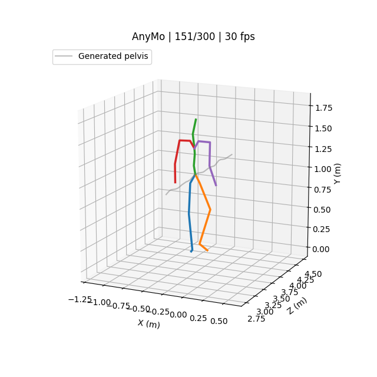

# Examples and visualization

Run commands from the repository root using Python 3.11. The skeleton renderer runs on CPU and needs neither model weights nor CUDA. Generating new motions uses the CUDA inference setup in the [README](../README.md).

## Render the included motion

[](walking.mp4)

[Watch/download the MP4](walking.mp4). The included `walking_joints.npz` contains a generated 22-joint skeleton, its prompt and frame rate. It is a 300-frame, 30 fps output from the released Stage3 3B checkpoint, with seed 3407, six native sampling steps and top-k threshold 0.9. It contains no reference dataset motion.

```bash
python -m pip install -r requirements/visualization.txt
python tools/render_motion.py examples/walking_joints.npz \
  --out outputs/walking_preview.mp4 --camera follow --poster outputs/walking_preview.png
```

The renderer reads `joints` with shape `(T, 22, 3)` and a scalar `fps` from an NPZ. It preserves world translation and maps the model's vertical Y axis to the vertical plot axis. The default `--camera fixed` uses common world bounds across the clip to show the complete path; `--camera follow` moves the camera bounds with the pelvis to keep the body larger on screen while retaining world-coordinate axis labels. The gray line is the generated pelvis path. When `target_traj` is present, a dashed black line shows the target path. Output is a 640×640 H.264 MP4 with no audio track; `--poster` optionally saves the middle frame as PNG.

To generate the included example again:

```bash
python tools/infer.py \
  --checkpoint work_dirs/anymo_stage_3_3B_210e_48gpu/lite_epoch_210.pth \
  --prompt "A person steadily walks forward, alternately stepping with the left and right foot while swinging their arms." \
  --frames 300 --seed 3407 --sampling-steps 6 --topk-threshold 0.9 \
  --out outputs/walking
python tools/render_motion.py outputs/walking/native.npz --out outputs/walking/motion.mp4
```

Exact numerical outputs can vary across GPU/software environments. The preview illustrates the skeleton output format; it does not establish motion quality across other prompts.

## Use the figure-eight trajectory

`examples/figure_eight.npy` is an analytic pelvis trajectory with 300 XYZ positions at 30 fps, in meters, with Y up. It starts at `(0, 0.95, 0)`, makes one figure-eight loop and returns to its starting point. The path is a synthetic input and is not taken from a reference motion sequence.

```bash
python tools/infer.py \
  --checkpoint work_dirs/anymo_stage_3_3B_210e_48gpu/lite_epoch_210.pth \
  --prompt "A person walks along a curved path." \
  --trajectory examples/figure_eight.npy --seed 3407 --out outputs/figure_eight
python tools/render_motion.py outputs/figure_eight/native.npz \
  --out outputs/figure_eight/native.mp4
```

Native trajectory conditioning is a soft constraint. For decoder-latent fitting, add `--tta-steps 400 --tta-lr 0.0002` to the inference command, then render `outputs/figure_eight/optimized.npz`. Fitting updates the continuous decoder latents while model weights remain fixed; it does not guarantee natural foot contact. See the README's trajectory section for details.

Create a different analytic path with the same coordinate convention:

```bash
python tools/make_trajectory.py --frames 120 --height 0.95 --radius 0.4 \
  --out outputs/custom_figure_eight.npy
```

The frame count must be a multiple of four between 60 and 300; height and radius are in meters. A zero pelvis height places the root on the floor. The inference command does not silently rotate, align or resample input paths.

## Render your own output

Both `native.npz` and `optimized.npz` from `tools/infer.py` can be rendered directly. To obtain a pelvis path from an existing generated output:

```python
import numpy as np

with np.load('outputs/walking/native.npz', allow_pickle=False) as sample:
    trajectory = sample['joints'][:, 0].astype(np.float32)
np.save('outputs/walking/pelvis.npy', trajectory)
```

Keep its original frame rate and world-coordinate convention. The public inference path expects 30 fps and 60–300 frames in multiples of four. See [data conventions](../docs/DATA_FORMAT.md) for the 272-dimensional motion representation; this renderer visualizes joint positions rather than exporting an SMPL mesh or BVH animation.
